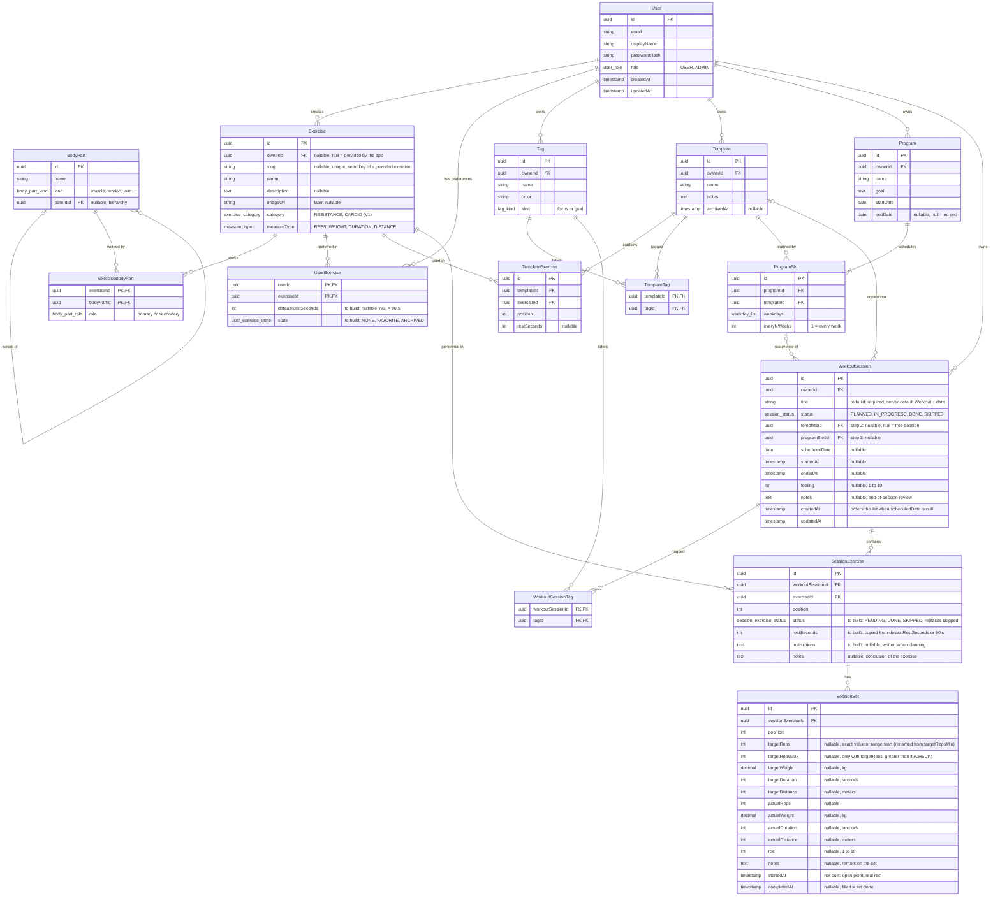

# MCD Workouts — v1

> **Statut : brouillon, va évoluer.** Version du 2026-11-14, mise à jour le 2026-11-22 avec les décisions du cadrage, le 2026-11-26 pour coller au `schema.prisma` de l'étape 1, puis le **2026-11-27 avec la révision de la V1** (cadrage §7.1). Les attributs marqués `to build:` sont décidés mais attendent la migration (voir « Écarts avec le schéma de l'étape 1 »).
> Modèle conceptuel des données du domaine Workouts (séances de sport), issu de l'analyse métier. Le périmètre et les décisions sont dans `00-cadrage-v1.md`, qui fait foi.
> `mcd-v1.html` est la version visuelle de ce document (publiée en artefact).

## Diagramme

## Règles clés

- **Prévu et réalisé sur la même ligne** : chaque `SessionSet` porte l'objectif (`target*`) et le réel (`actual*`) côte à côte. Une série est **faite** quand `completedAt` est rempli.
- **Cycle de vie de la séance** : `PLANNED` → *Start* → `IN_PROGRESS` → *Finish* → `DONE`, et *Reopen* (`DONE` → `IN_PROGRESS`) pour corriger. `SKIPPED` est réservé à l'étape 2. Une seule séance `IN_PROGRESS` à la fois.
- **Séance `DONE` figée** : aucune écriture ni suppression tant qu'elle n'est pas rouverte (cadrage §4.5).
- **Objectifs figés au Start** : `target*`, `restSeconds` et `instructions` ne bougent plus en `IN_PROGRESS`. Un exercice ou une série ajouté en cours de séance n'a pas d'objectif ; un exercice prévu non fait passe en `SKIPPED`, il n'est pas supprimé (cadrage §4.4).
- **Titre de séance** : obligatoire en base, rempli par le serveur s'il manque (« Workout Nov 27 »). Non unique, affichage seulement : retrouver « la dernière Push » passera par le template (`templateId`), jamais par le titre.
- **Objectif de reps** : `targetReps` seul = valeur exacte ; avec `targetRepsMax` = fourchette. `targetRepsMax` n'existe pas sans `targetReps` et lui est strictement supérieur (contrainte `CHECK` en base).
- **Exercice de séance** : `status` (`PENDING`, `DONE`, `SKIPPED`) ; « en cours » = le premier `PENDING`. `restSeconds` est copié de `UserExercise.defaultRestSeconds`, sinon 90 s. `instructions` = la consigne écrite en planifiant ; `notes` = la conclusion.
- **Préférences par utilisateur** : `UserExercise` ne porte que ce qui relie un utilisateur à un exercice hors séance : `defaultRestSeconds` et `state` (`NONE`, `FAVORITE`, `ARCHIVED` : favori **et** archivé est impossible à écrire). Ligne créée à la première préférence (upsert). Un exercice archivé disparaît du sélecteur, pas de l'historique. `Exercise` n'a pas d'`archivedAt`.
- **Template = moule sans chiffres** : `TemplateExercise` ne porte que l'exercice, sa position et le repos. Les objectifs sont saisis à la **planification** d'une occurrence, qui crée la `WorkoutSession` en `PLANNED` et ses `SessionSet`. « Reprendre la dernière séance » copie les **objectifs** ; « Surcharge progressive » propose +2,5 kg et remet les reps à `targetReps` (cadrage §5.3).
- **Historique figé** : modifier un template ou un programme ne réécrit jamais les séances passées. Templates et exercices s'archivent, ils ne se suppriment pas.
- **Catalogue partagé** : un exercice avec `ownerId` à `null` est fourni par l'app et n'est jamais modifiable. L'utilisateur crée ses propres exercices de zéro (`variantOfId` retiré le 2026-11-26).
- **Occurrences de programme calculées** : on stocke la règle (`ProgramSlot`), pas les occurrences. Une occurrence ne devient une `WorkoutSession` que lorsqu'on la planifie.
- **Unités stockées** : kg pour la charge, secondes pour la durée, mètres pour la distance. L'affichage convertit.
- **Métriques en colonnes fixes** : `measureType` dit quels champs s'appliquent (`REPS_WEIGHT` : reps + charge ; `DURATION_DISTANCE` : durée + distance). Charge 0 = poids du corps ; une distance qui ne s'applique pas reste `null`, jamais 0. `category` ne sert qu'au filtre du catalogue.
- **Objectif = tag `goal` sur la séance** (étape 2, template ou `WorkoutSession`), jamais sur l'exercice.

## Écarts avec le schéma de l'étape 1 (2026-11-27)

Ce MCD décrit le modèle **cible** (étapes 1 et 2). `apps/api/prisma/schema.prisma` n'en construit qu'une partie. Dans le diagramme, le préfixe du commentaire d'un attribut dit pourquoi il manque au schéma :

- **`to build:`** : décidé pour la V1 le 2026-11-27, arrive par la prochaine migration (cadrage §9) :
  - `WorkoutSession.title` ;
  - `SessionExercise.status` (remplace `skipped`), `restSeconds`, `instructions` ;
  - `SessionSet.targetReps` (renommage de `targetRepsMin`) et la contrainte `CHECK` sur `targetRepsMax` ;
  - `UserExercise.defaultRestSeconds`, `state` ; et **suppression** de `UserExercise.notes`.
- **`step 2:`** : arrive avec les templates et programmes (`WorkoutSession.templateId`, `programSlotId`).
- **`later:`** : prévu, ajouté quand la fonctionnalité sera construite (`Exercise.imageUrl`).
- **`not built:`** : pas encore décidé (`SessionSet.startedAt`, voir les points ouverts).

À l'inverse, le schéma a ajouté en phase 0 :

- **`Exercise.slug`** : clé stable du seed (`"bench-press"`), remplie pour les exercices fournis, `null` pour les exercices perso. Interne : jamais renvoyée par l'API.
- **`WorkoutSession.createdAt` / `updatedAt`** : `createdAt` trie la liste quand `scheduledDate` est vide, et date le titre par défaut.

**Règles de suppression** (phase 0) : séance → exercices → séries en `Cascade` ; un exercice utilisé dans une séance en `Restrict` (l'historique en a besoin) ; un utilisateur → ses exercices, préférences et séances en `Cascade`.

## Points ouverts

- **Repos réel** : `startedAt` par série (précis) ou approximation entre deux validations. Après la V1, avec le minuteur.
- **Étape 2** (la liste à jour est au §10 du cadrage) :
  1. Clôture automatique d'une séance oubliée ?
  2. Une séance faite à la place d'une autre la remplace-t-elle ?
  3. Modification d'un programme en cours : seules les occurrences futures changent ? Arrêter = `endDate` à aujourd'hui ?
  4. Plusieurs programmes actifs en même temps ?
  5. Séance manquée : calculée seulement, ou aussi marquable (`SKIPPED`) ?
  6. Séance précédente d'un template copié : retrouvée par `programSlotId` ou par un lien copie → original ?

## Décisions tranchées

### 2026-11-27 (révision de la V1, cadrage §7.1)

- Titre de séance obligatoire en base, défaut rempli par le serveur, non unique.
- Deux notes sur l'exercice de séance : `instructions` (planification) et `notes` (conclusion) ; `SessionSet.notes` en V1.
- `UserExercise.notes` supprimée ; `UserExercise` = `defaultRestSeconds` + `state`, en V1.
- Repos : `SessionExercise.restSeconds`, pré-rempli par `UserExercise.defaultRestSeconds`, sinon 90 s.
- Objectif de reps : `targetReps` + `targetRepsMax` facultatif, contrainte `CHECK`.
- Objectifs figés au *Start* ; `SessionExercise.status` remplace `skipped`.
- Séance `DONE` figée, *Reopen* pour corriger.

### 2026-11-22

- Stockage des métriques : colonnes fixes + `measureType` (le tableau `metric_list` et la table `ExerciseMetric` sont écartés).
- Mise à jour du template : toujours manuelle ; en cours de programme, l'utilisateur choisit de modifier le template ou d'en créer une copie.
- Nom dans l'historique : le nom actuel de l'exercice.
- Une seule séance `IN_PROGRESS` à la fois ; une séance non terminée se supprime (avec ses exercices et séries).
- Exercices personnels : création et modification du nom ; le profil de mesure est figé dès qu'il a servi ; archivage au lieu de suppression.
