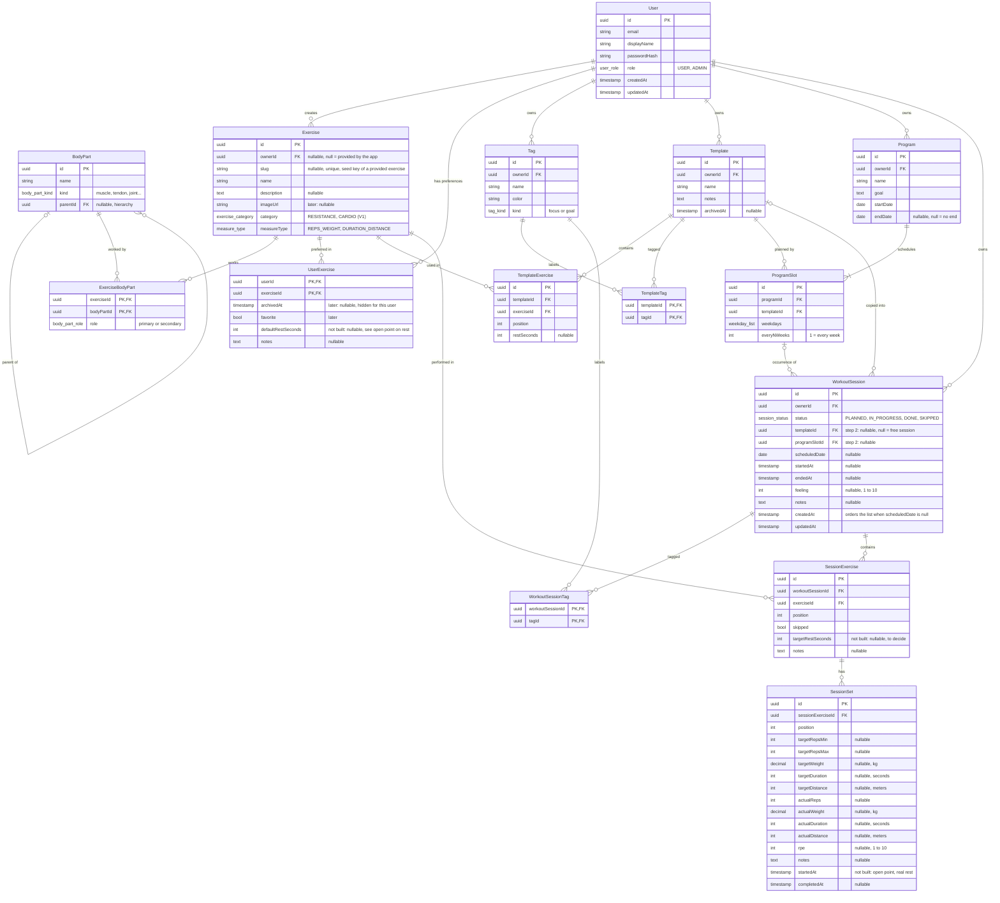

# MCD Workouts — v1

> **Statut : brouillon, va évoluer.** Version du 2026-11-14, mise à jour le 2026-11-22 avec les décisions du cadrage, puis le 2026-11-26 pour coller au `schema.prisma` de l'étape 1 (voir « Écarts avec le schéma de l'étape 1 »).
> Modèle conceptuel des données du domaine Workouts (séances de sport), issu de l'analyse métier. Le périmètre et les décisions sont dans `00-cadrage-v1.md`, qui fait foi.
> `mcd-v1.html` est la version visuelle de ce document (publiée en artefact).

## Diagramme

## Règles clés

- **Prévu et réalisé sur la même ligne** : une `WorkoutSession` change de `status` (`planned` → `in_progress` → `done`, ou `skipped`). Chaque `SessionSet` porte l'objectif (`target*`) et le réel (`actual*`) côte à côte.
- **Séance libre** : créée en `planned` (`scheduledDate` facultative), elle passe en `in_progress` uniquement par un clic sur *Start session*. `templateId` et `programSlotId` sont vides.
- **Template = moule sans chiffres** : `TemplateExercise` ne porte que l'exercice, sa position et le repos. Les objectifs sont saisis à la **planification** d'une occurrence, qui crée la `WorkoutSession` en `planned` et ses `SessionSet` (une ligne par série). « Reprendre la dernière séance » copie les **objectifs** de la séance précédente ; « Surcharge progressive » propose +2,5 kg et remet les reps au minimum (cf. cadrage §5.3).
- **Pendant la séance** : un exercice ajouté en cours de séance n'a pas de `target*`, un exercice retiré est marqué `skipped`. Le nombre de séries est le nombre de lignes `SessionSet`.
- **Historique figé** : modifier un template ou un programme ne réécrit jamais les séances passées. Templates et exercices s'archivent, ils ne se suppriment pas.
- **Catalogue partagé** : un exercice avec `ownerId` à `null` est fourni par l'app. Il n'est jamais modifiable : l'utilisateur crée ses propres exercices de zéro. Copier un exercice fourni (`variantOfId`) est retiré du modèle et rangé hors périmètre (cadrage §2, 2026-11-26).
- **Archivage par utilisateur** : `UserExercise.archivedAt` masque un exercice pour un seul utilisateur (exercice fourni ou personnel). `Exercise` n'a pas d'`archivedAt`.
- **Occurrences de programme calculées** : on stocke la règle (`ProgramSlot`), pas les occurrences. Une occurrence ne devient une `WorkoutSession` que lorsqu'on y touche (démarrage, modification, séance manquée marquée).
- **Unités stockées** : kg pour la charge, secondes pour la durée, mètres pour la distance. L'affichage convertit.
- **Métriques en colonnes fixes** : `measureType` dit quels champs s'appliquent (`REPS_WEIGHT` : reps + charge ; `DURATION_DISTANCE` : durée + distance). Charge 0 = poids du corps ; une distance qui ne s'applique pas reste `null`, jamais 0. `category` ne sert qu'au filtre du catalogue.
- **Note durable** : une consigne permanente sur un exercice va dans `UserExercise.notes`.
- **Objectif = tag `goal` sur la séance** (template ou `WorkoutSession`), jamais sur l'exercice. L'exercice ne porte que sa nature (`category`).

## Écarts avec le schéma de l'étape 1 (2026-11-26)

Ce MCD décrit le modèle **cible** (étapes 1 et 2). `apps/api/prisma/schema.prisma` n'en construit qu'une partie. Dans le diagramme, le préfixe du commentaire d'un attribut dit pourquoi il manque au schéma :

- **`step 2:`** : arrive avec les templates et programmes (`WorkoutSession.templateId`, `programSlotId`), par une migration.
- **`later:`** : prévu, mais ajouté quand la fonctionnalité sera construite (`Exercise.imageUrl` ; `UserExercise.archivedAt`, `favorite`).
- **`not built:`** : absent du schéma et pas encore décidé (`SessionExercise.targetRestSeconds`, `UserExercise.defaultRestSeconds`, `SessionSet.startedAt`, voir les points ouverts).

À l'inverse, le schéma a ajouté en phase 0 :

- **`Exercise.slug`** : clé stable du seed (`"bench-press"`), remplie pour les exercices fournis, `null` pour les exercices perso. Interne : jamais renvoyée par l'API.
- **`WorkoutSession.createdAt` / `updatedAt`** : `createdAt` trie la liste quand `scheduledDate` est vide.

**Règles de suppression** (phase 0) : séance → exercices → séries en `Cascade` ; un exercice utilisé dans une séance en `Restrict` (l'historique en a besoin) ; un utilisateur → ses exercices, notes et séances en `Cascade`.

## Points ouverts

- **Repos visé** (cadrage §8, point 10) : `SessionExercise.targetRestSeconds` est dans ce MCD et le cadrage (« repos visé », §6), mais pas dans le schéma de l'étape 1. Oubli à rattraper par une migration, ou reporté à l'étape 2 avec les templates ? `UserExercise.defaultRestSeconds` (le repos habituel de l'utilisateur, qui pré-remplit le repos visé) suit la même décision : sans repos visé, il n'a rien à pré-remplir.
- **Repos réel** : `startedAt` par série (précis) ou approximation entre deux validations.
- **Cycle de vie** (la liste à jour, avec ce qui bloque la V1, est au §8 du cadrage) :
  1. Clôture automatique d'une séance oubliée ?
  2. Une séance faite à la place d'une autre la remplace-t-elle ?
  3. Modification d'un programme en cours : seules les occurrences futures changent ? Arrêter = `endDate` à aujourd'hui ?
  4. Plusieurs programmes actifs en même temps ?
  5. Séance manquée : calculée seulement, ou aussi marquable (`skipped` avec une note) ?
  7. Séance précédente d'un template copié : retrouvée par `programSlotId` ou par un lien copie → original ?

## Décisions tranchées (2026-11-22)

- Stockage des métriques : colonnes fixes + `measureType` (le tableau `metric_list` et la table `ExerciseMetric` sont écartés).
- Mise à jour du template : toujours manuelle ; en cours de programme, l'utilisateur choisit de modifier le template ou d'en créer une copie.
- Démarrage : séance libre à l'étape 1, séance planifiée depuis un programme à l'étape 2.
- Nom dans l'historique : le nom actuel de l'exercice.
- Une seule séance `in_progress` à la fois ; une séance non terminée se supprime (avec ses exercices et séries) ; une séance terminée reste modifiable.
- Exercices personnels en V1 : création et modification du nom ; le profil de mesure est figé dès qu'il a servi ; pas de suppression ni de variante.
